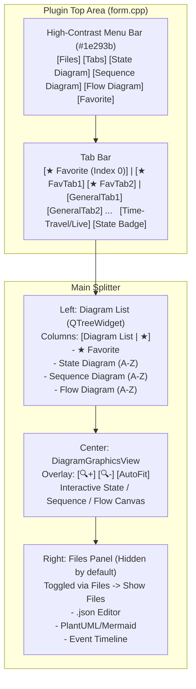

# DLT Diagram Plugin (`dltdiagramplugin`) 통합 설계 및 구현 계획서 (`Plan-Plugin.md`)

## 1. 개요 및 목표 (Overview & Goals)

**DLT Diagram Plugin (`dltdiagramplugin`)**은 DLT Viewer 내에서 JSON 설정 및 PlantUML / Mermaid 스크립트를 기반으로 **State Diagram(상태 다이어그램)**, **Sequence Diagram(시퀀스 다이어그램)**, **Flow Diagram(플로우 다이어그램)**을 시각화하고, DLT 로그와 실시간(Live) 및 선택 시점(Time-Travel)으로 연동하여 현재 상태와 진행 흐름을 표시하는 플러그인입니다.

또한 복잡한 툴바 버튼들과 불필요한 설정 탭을 모두 제거하고:
- **Title 바로 아래 고대비(High-Contrast) `File` 스타일 메뉴바(`m_menuBarWidget`)**
- **최좌측(Index 0) `★ Favorite` 전용 탭 + Favorite 탭 우선 정렬 + Diagram List 내 즉시 `★`/`☆` 토글**
- **다이어그램 캔버스 내부 우측 상단 돋보기(`🔍+`/`🔍-`) 확대/축소 + `AutoFit` 자동 맞춤 토글**
- **단순화된 2-탭 다이어그램 빌더(`1. Nodes & Transitions (+ DLT Log Matching)` / `2. PlantUML / Mermaid Script`)**
를 통해 직관적이고 깔끔한 사용자 경험을 제공합니다.

---

## 2. 핵심 기능 및 간소화된 UI 명세 (Core Features & Simplified UI)

### 2.1 간소화된 상단 레이아웃 및 고대비 메뉴바 (`m_menuBarWidget`)
- 불필요한 `"Tabs (.json):"` 라벨, 탭 이동 버튼(`◀`/`▶`), 복잡한 상/하단 버튼 툴바를 모두 제거했습니다.
- Windows 다크 모드에서 기본 `QMenuBar`가 흰색 배경에 흰색 글씨로 렌더링되는 문제를 방지하기 위해, 고대비 슬레이트 다크(`#1e293b`) 배경과 선명한 흰색(`#f8fafc`, Bold) 텍스트, 파란색(`#2563eb`) 하이라이트가 적용된 File 스타일 메뉴바([`Form::setupMenus`](file:///c:/Work/git/dlt-viewer/plugin/dltdiagramplugin/form.cpp#L270-L398))를 Title 바로 아래에 배치했습니다:
  - **`Files`**
    - `Show Files` (체크 토글: 우측 JSON / PlantUML·Mermaid Script / Event Timeline 패널 표시/숨김)
    - `Reload Diagram` (재시작 없이 JSON 워크스페이스 즉시 리로드 및 현재 DLT 로그 전체 재스캔)
  - **`Tabs`**
    - `Create` (새 탭 추가 및 `<TabName>.json` 자동 생성 + 탭 색상 선택)
    - `Edit` (현재 탭 이름 변경 및 탭 색상 수정)
    - `Delete` (현재 탭 닫기 또는 `.json` 파일 삭제)
    - `General Ordering` (일반 탭들의 표시 순서 조정 다이얼로그)
    - `Favorite Toggle` (현재 탭의 즐겨찾기 `★` 등록/해제 토글)
  - **`State Diagram`**
    - `Create`, `Edit`, `Delete`
  - **`Sequence Diagram`**
    - `Create`, `Edit`, `Delete`
  - **`Flow Diagram`**
    - `Create`, `Edit`, `Delete`
  - **`Favorite`**
    - `List` (즐겨찾기된 Tab 및 Diagram 전체 관리 및 추가/삭제 다이얼로그)

### 2.2 다중 탭(Tab) 배치 순서 및 Tab / Diagram 이중 Favorite 지원
- **탭 바(`m_tabBar`) 배치 순서 ([`Form::refreshTabBar`](file:///c:/Work/git/dlt-viewer/plugin/dltdiagramplugin/form.cpp#L438-L501))**:
  1. **제일 왼쪽(첫 번째, Index 0): `★ Favorite` 전용 탭**
     - 탭 바 맨 왼쪽에 항상 고정 배치되며, 선택 시 즐겨찾기된 다이어그램 리스트(`★ Favorite Diagrams`)와 전체 다이어그램 리스트(`All Diagrams`)를 함께 보여주어 바로 조회 및 추가/삭제가 가능합니다.
  2. **그 다음: Favorite에 등록된 탭 (`★ <TabName>`)**
     - `Tabs -> Favorite Toggle`(또는 탭 우클릭 메뉴)로 즐겨찾기에 등록한 탭들이 일반 탭보다 먼저 표시됩니다.
  3. **마지막: 일반 탭 (`<TabName>`)**
     - `Tabs -> General Ordering`(또는 탭 드래그) 순서대로 표시됩니다.
- **탭 = 개별 JSON 파일 (`<TabName>.json`) 및 탭 색상 (`Tab Color`)**:
  - 탭을 추가할 때마다 설정 폴더(`Workspace Directory`) 내에 `<탭이름>.json` 파일이 자동으로 생성되며, 각 탭마다 고유 강조 색상(`QColor`)을 지정할 수 있습니다.
- **Diagram List에서 즉시 Favorite 추가/삭제 ([`Form::refreshCategoryTree`](file:///c:/Work/git/dlt-viewer/plugin/dltdiagramplugin/form.cpp#L536-L660))**:
  - 일반 탭 선택 시에도 좌측 **Diagram List 최상단에 `★ Favorite` 섹션**이 별도로 표시됩니다.
  - Diagram List 우측의 **`★` / `☆` 별표 컬럼(2번째 열)을 클릭**하거나 **우클릭 메뉴(`★ Add to Favorite` / `☆ Remove from Favorite`)**, 또는 **`Favorite -> List` 메뉴**에서 다이어그램 즐겨찾기를 즉시 추가/삭제할 수 있습니다.
- **Configuration 영구 저장 (`QDltSettingsManager`)**:
  - 다이어그램 즐겨찾기(`plugin/dltdiagramplugin/favorites`), 탭 즐겨찾기(`plugin/dltdiagramplugin/favoriteTabs`), 일반 탭 정렬 순서(`plugin/dltdiagramplugin/tabOrder`), 탭 색상(`plugin/dltdiagramplugin/tabColors`), 작업 폴더 경로(`plugin/dltdiagramplugin/workspaceDir`)는 각 사용자의 DLT Viewer Configuration에 영구 저장됩니다.

### 2.3 다이어그램 캔버스 내부 돋보기(`🔍+`/`🔍-`) 확대/축소 및 `AutoFit` 활성 기능
- 외부 툴바의 확대/축소 버튼을 제거하고, **다이어그램 캔버스([`DiagramGraphicsView`](file:///c:/Work/git/dlt-viewer/plugin/dltdiagramplugin/diagramgraphicsview.h)) 우측 상단 내부에 반투명 플로팅 컨트롤**을 배치했습니다:
  - **`🔍+` (돋보기 확대)** / **`🔍-` (돋보기 축소)**: 커스텀 렌더링된 돋보기 아이콘 버튼으로 다이어그램 안에서 직관적으로 확대/축소 가능 (수동 확대/축소 시 `AutoFit` 자동 해제)
  - **`AutoFit` (자동 맞춤 활성 토글, 기본 ON)**: 활성화 시 다이어그램 전환, 로그 업데이트, 창 크기 조절(`resizeEvent`) 시마다 다이어그램이 뷰 크기에 맞춰 자동으로 최적 배율로 조정됩니다.

### 2.4 각 탭 내부의 3대 다이어그램 카테고리 (이름순 자동 정렬)
1. **State Diagram (상태 다이어그램 - 이름순 정렬)**
   - 초기 상태(`[*] --> InitialState`), 상태 노드, 전이 화살표(`From --> To : Transition Name`) 시각화
   - 선택된 DLT 로그 시점의 **Current State(현재 활성 상태)**, **직전 전이 화살표**, **상태별 누적 방문 횟수(`Visits: N`)** 하이라이트
2. **Sequence Diagram (시퀀스 다이어그램 - 이름순 정렬)**
   - 참여자(Participant) Lifeline 및 시간순 메시지 화살표(`Caller -> Callee : Transition Name`, `sync`/`async`/`reply`) 시각화
   - 선택된 DLT 로그 시점의 **활성 단계 배너(`▶ CURRENT`)** 및 이후 시점(Future Horizon) 구분 표시
3. **Flow Diagram (플로우 다이어그램 - 이름순 정렬)**
   - 프로세스/알고리즘 단계 노드(시작/종료 둥근 노드, 일반 처리 사각형, 조건 분기 다이아몬드 `{Condition?}` 지원)와 흐름 화살표 시각화
   - DLT 로그 기반으로 현재 실행 중인 플로우 단계(**Active Step**)와 지금까지 거쳐온 경로(**Visited Path**)를 실시간 하이라이트

### 2.5 DLT Viewer 내장 GUI 다이어그램 생성기 (`DiagramBuilderDialog`) 및 무중단 Hot-Reload
- **불필요한 `"2. Advanced Dynamic Rules & Guide"` 탭 제거 및 2-탭 구조 단순화**:
  - 복잡했던 `"2. Advanced Dynamic Rules & Guide"` 탭을 제거하고, 직관적인 2개 탭으로 구성했습니다:
    1. **`1. Nodes & Transitions (+ DLT Log Matching)`**:
       - 상태/참여자/플로우 단계 노드 테이블 편집
       - Transition 테이블에서 **`From (Drop-Down)`**, **`To (Drop-Down)`** 으로 노드를 선택하고, **`Transition Name`**, **`ECUID`**, **`APID`**, **`CTID`**, **`DLT Log Matching (Keyword / Regex)`**, **`Arrow Style`** 을 한 줄에서 바로 입력
    2. **`2. PlantUML / Mermaid Script`**:
       - 테이블과 PlantUML / Mermaid 스크립트 간 양방향 변환 및 프리뷰 제공
  - 하단에는 **Live DLT Log Matching Tester**를 배치하여 샘플 DLT 로그 문자열 입력 시 어떤 Transition이 매칭되는지 즉시 테스트할 수 있습니다.

---

## 3. UI 레이아웃 및 아키텍처 다이어그램 (Architecture & Layout)

---

## 4. 파일 구성 및 모듈 설계 (File Structure)

| 파일 경로 | 역할 및 주요 변경 내용 |
| :--- | :--- |
| [diagrammodel.h](file:///c:/Work/git/dlt-viewer/plugin/dltdiagramplugin/diagrammodel.h) / [diagrammodel.cpp](file:///c:/Work/git/dlt-viewer/plugin/dltdiagramplugin/diagrammodel.cpp) | `DiagramType::FlowDiagram` 및 플로우 노드 형태(`Shape`), 카테고리별 이름순 정렬 헬퍼, Transition 내장 DLT Log Matching 직렬화/역직렬화, 다중 탭(`DiagramTabFile`) 모델 정의 |
| [diagramengine.h](file:///c:/Work/git/dlt-viewer/plugin/dltdiagramplugin/diagramengine.h) / [diagramengine.cpp](file:///c:/Work/git/dlt-viewer/plugin/dltdiagramplugin/diagramengine.cpp) | 다중 탭/다이어그램 키(`tabName::diagramId`) 기반 이벤트 인덱싱, Tab Favorite 우선 정렬(`favoriteTabs` + `generalTabOrder`), Diagram Favorite 관리 |
| [diagramgraphicsview.h](file:///c:/Work/git/dlt-viewer/plugin/dltdiagramplugin/diagramgraphicsview.h) / [diagramgraphicsview.cpp](file:///c:/Work/git/dlt-viewer/plugin/dltdiagramplugin/diagramgraphicsview.cpp) | 다이어그램 캔버스 내부 우측 상단 돋보기(`🔍+`/`🔍-`) 확대/축소 버튼 및 `AutoFit` 토글 오버레이 위젯 내장, State/Sequence/Flow 렌더링 |
| [diagrambuilderdialog.h](file:///c:/Work/git/dlt-viewer/plugin/dltdiagramplugin/diagrambuilderdialog.h) / [diagrambuilderdialog.cpp](file:///c:/Work/git/dlt-viewer/plugin/dltdiagramplugin/diagrambuilderdialog.cpp) | 2-탭 구조로 단순화된 GUI 다이어그램 생성/편집 마법사 (`1. Nodes & Transitions (+ DLT Log Matching)`, `2. PlantUML / Mermaid Script`, 실시간 로그 매칭 테스터) |
| [form.h](file:///c:/Work/git/dlt-viewer/plugin/dltdiagramplugin/form.h) / [form.cpp](file:///c:/Work/git/dlt-viewer/plugin/dltdiagramplugin/form.cpp) | 고대비 다크 메뉴바(`Files`, `Tabs`, `State Diagram`, `Sequence Diagram`, `Flow Diagram`, `Favorite`), `★ Favorite` 전용 탭 최좌측(Index 0) 배치 및 Favorite 탭 우선 배치, Diagram List 키보드 탐색 및 `★`/`☆` 클릭 토글 |
| [dltdiagramplugin.h](file:///c:/Work/git/dlt-viewer/plugin/dltdiagramplugin/dltdiagramplugin.h) / [dltdiagramplugin.cpp](file:///c:/Work/git/dlt-viewer/plugin/dltdiagramplugin/dltdiagramplugin.cpp) | 폴더/다중 JSON 파일 로드·저장, `QDltSettingsManager` 기반 개인별 Tab/Diagram Favorites 및 탭 순서 영속화 |

---

## 5. 전반적인 동작 및 UX 검토 결과 및 보완 내역 (UX & Behavior Review)

1. **Diagram List 키보드 방향키(`↑`/`↓`, `Home`/`End`, `PageUp`/`PageDown`) 자동 활성화 지원**:
   - **원인**: 기존에는 `QTreeWidget::itemClicked` 시그널만 연결되어 있어 마우스 클릭 시에만 다이어그램이 전환되고 키보드 방향키 이동 시에는 다이어그램이 활성화되지 않았습니다.
   - **보완**: [`Form::onCategoryTreeCurrentItemChanged`](file:///c:/Work/git/dlt-viewer/plugin/dltdiagramplugin/form.cpp#L1217-L1241) 슬롯을 추가하고 `QTreeWidget::currentItemChanged` 시그널에 연결하여, 키보드로 항목을 이동할 때마다 즉시 해당 다이어그램과 타임라인이 자동 활성화되도록 개선했습니다.

2. **Diagram List 내 그룹 위치 유지 (커서 점프 방지)**:
   - **원인**: 즐겨찾기에 등록된 다이어그램은 상단 `★ Favorite` 그룹과 하단 카테고리(`State` / `Sequence` / `Flow` 또는 `All Diagrams`) 두 곳에 동시에 표시됩니다. 기존에는 트리를 새로고침할 때 무조건 상단 `★ Favorite` 그룹의 항목이 선택되어, 하단 카테고리에서 키보드 이동이나 `★`/`☆` 토글 시 포커스가 상단으로 튀는 현상이 있었습니다.
   - **보완**: `m_preferFavoriteGroupInTree` 플래그로 사용자가 현재 탐색 중인 그룹(`★ Favorite` vs 일반 카테고리)을 기억하여, 별표 토글이나 리프레시 후에도 포커스가 원래 그룹에 그대로 유지되도록 개선했습니다.

3. **빈 탭(Empty Tab) 생성 및 다이어그램 전체 삭제 시 빈 화면(Empty State) 처리**:
   - **원인**: `Tabs -> Create`로 새 탭을 만들었을 때 해당 탭에 아직 다이어그램이 없으면(`m_currentDiagramIdx == -1`), 이전 탭의 다이어그램이 캔버스에 그대로 남아 있는 문제가 있었습니다.
   - **보완**: [`DiagramGraphicsView::clearCanvasWithMessage`](file:///c:/Work/git/dlt-viewer/plugin/dltdiagramplugin/diagramgraphicsview.cpp#L245-L262)를 추가하여 현재 탭에 선택 가능한 다이어그램이 없을 때 이전 화면을 깨끗이 지우고 안내 메시지를 표시하도록 보완했습니다.

4. **초기 실행 시 스마트 탭 선택 (`★ Favorite` 최좌측 고정 유지)**:
   - **원인**: `★ Favorite` 탭을 제일 왼쪽(Index 0)에 배치했을 때, 아직 즐겨찾기한 다이어그램이 하나도 없는 초기 상태에서는 빈 즐겨찾기 그룹이 먼저 보였습니다.
   - **보완**: `★ Favorite` 탭은 항상 제일 왼쪽(Index 0)에 고정하되, 최초 실행 시 즐겨찾기된 다이어그램이 있으면 `★ Favorite`(Index 0)을 선택하고, 즐겨찾기가 비어 있으면 첫 번째 사용자 탭(Index 1)을 자동 선택하도록 UX를 개선했습니다.

5. **다이어그램 최초 표시 시점(`showEvent`)의 `AutoFit` 정밀도 보완**:
   - **원인**: 플러그인 위젯이 화면에 처음 표시되기 전(생성자 시점)에는 뷰포트 크기가 작아 초기 `AutoFit` 배율이 부정확할 수 있었습니다.
   - **보완**: [`DiagramGraphicsView::showEvent`](file:///c:/Work/git/dlt-viewer/plugin/dltdiagramplugin/diagramgraphicsview.cpp#L205-L212)에서도 `repositionOverlayControls()`와 `fitDiagramInView()`가 수행되도록 보완하여 최초 탭 진입 시에도 화면에 꽉 차게 렌더링됩니다.

6. **Event Timeline 키보드 탐색(`↑`/`↓`) 연동 및 Transition 노드 자동 등록**:
   - **보완 1**: 우측 `Event Timeline` 테이블에서도 마우스 클릭뿐 아니라 키보드 `↑`/`↓` 이동([`Form::onTimelineCurrentCellChanged`](file:///c:/Work/git/dlt-viewer/plugin/dltdiagramplugin/form.cpp#L1463-L1471)) 시 즉시 해당 DLT 로그로 점프하고 다이어그램 상태를 갱신하도록 개선했습니다.
   - **보완 2**: 다이어그램 빌더(`DiagramBuilderDialog`)의 Transition 테이블 `From`/`To` 드롭다운에 새로운 노드 이름을 직접 타이핑한 경우에도 저장 시 자동으로 `nodes` 목록에 등록되도록 보완했습니다.

