# DLT Viewer Android Logcat 기능 추가 계획 (Plan.md)

## 1. 개요 (Overview)
본 계획서는 COVESA DLT Viewer에 Android Logcat 지원 기능을 추가하기 위한 아키텍처 및 구현 방안을 정의합니다.

### 주요 목표
1. **Android Live Log 연결**: ADB(Android Debug Bridge)를 통해 실시간으로 Android 단말/에뮬레이터의 `logcat` 스트림을 수신하고, 이를 DLT 메시지(`QDltMsg`)로 변환하여 메인 테이블에 실시간 표시.
2. **Text based Logcat 로그 파일 처리**: 텍스트 형태의 Logcat 덤프 파일(`.log`, `.txt`, `.logcat`)을 열어 DLT Storage Header와 페이로드로 변환하여 DLT Viewer에서 필터링, 검색, 탐색이 가능하도록 지원.

---

## 2. 아키텍처 및 데이터 매핑 설계

### 2.1 Logcat $\leftrightarrow$ DLT 데이터 매핑
Android Logcat의 주요 포맷(`threadtime` 기준):
```text
MM-DD hh:mm:ss.mmm   PID   TID Priority Tag: Message
05-18 14:23:45.678  1234  5678 D        ActivityManager: Starting activity...
```

| Android Logcat 필드 | DLT 필드 (`QDltMsg`) | 매핑 및 처리 방식 |
| :--- | :--- | :--- |
| **Timestamp** (`MM-DD hh:mm:ss.mmm`) | `time` & `microseconds` (`DltStorageHeader`) | 시스템 Unix Timestamp(초) 및 마이크로초 단위로 변환 |
| **Log Priority** (`V/D/I/W/E/F/A`) | DLT Subtype (`DltLogDef`) | `V` $\rightarrow$ `DltLogVerbose`<br>`D` $\rightarrow$ `DltLogDebug`<br>`I` $\rightarrow$ `DltLogInfo`<br>`W` $\rightarrow$ `DltLogWarn`<br>`E` $\rightarrow$ `DltLogError`<br>`F/A` $\rightarrow$ `DltLogFatal` |
| **PID** (Process ID) | `sessionid` | 32-bit 프로세스 ID |
| **TID** (Thread ID) | `ctid` | 하위 4자리 포맷팅 (예: `5678`) |
| **Tag** | `apid` & Payload 본문 | DLT의 4글자 제한에 맞춰 영숫자 4자리 추출(`apid`), 원본 태그는 메시지 본문(`[Tag] Message`)에 보존 |
| **Message** | Payload Argument (`QDltArgument`) | 문자열 타입(`DltTypeInfoStrg`)으로 인코딩하여 전체 검색 및 정규식 필터링 지원 |
| **ECU ID** | `ecuid` | 기본값 `ANDR` 또는 ECU 설정에서 지정한 ID |

```mermaid
flowchart TD
    subgraph Live Streaming [1. Android Live Log Streaming]
        ADB[QProcess: adb logcat] -->|stdout 라인| LiveParser[QDltConnection::parseLogcat]
        LiveParser -->|QDltMsg 생성| LiveStore[MainWindow::writeDLTMessageToFile]
        LiveStore --> LiveTable[DLT Viewer Main Table & Filters]
    end

    subgraph Offline Import [2. Text based Logcat Import]
        LogFile[Text File: .log / .txt / .logcat] --> Importer[QDltImporter::dltFromLogcat]
        Importer -->|DLT Storage Frame 변환| TempDlt[임시 .dlt 파일]
        TempDlt --> Reload[MainWindow::reloadLogFile]
        Reload --> LiveTable
    end
```



---

## 3. 세부 컴포넌트별 변경 계획

### Component 1: `qdlt` 코어 라이브러리 (프로토콜 & 파싱)
1. **`qdlt/qdltconnection.h` & `qdlt/qdltconnection.cpp`**
   - `parseLogcat(QDltMsg &msg, const QString &defaultEcuId)`: 스트림 버퍼에서 줄바꿈 단위로 Logcat 메시지 파싱.
   - `parseLogcatLine(const QString &line, QDltMsg &msg, const QString &defaultEcuId, unsigned char msgCounter)`:
     - `threadtime` 및 `brief/time` 정규식 기반 매칭.
     - 매칭 실패 시 일반 텍스트 라인 Fallback 처리.
     - 우선순위 $\rightarrow$ DLT 로그 레벨 변환 및 `QDltArgument` 생성.
2. **`qdlt/qdltimporter.h` & `qdlt/qdltimporter.cpp`**
   - `dltFromLogcat(QString fileName)` 구현:
     - 텍스트 파일을 라인 단위로 읽어 DLT Storage Header와 함께 변환.
     - 진행률(`progress`) 시그널 발생.
   - `QDltImporter::run()`에서 `.log`, `.txt`, `.logcat` 확장자 감지 시 `dltFromLogcat` 호출.

---

### Component 2: ECU 및 프로젝트 모델 (`src`)
1. **`src/project.h` & `src/project.cpp`**
   - `EcuItem` 인터페이스 타입에 `INTERFACETYPE_ANDROID_LOGCAT` 추가.
   - Android 관련 설정 멤버 추가:
     - `QString adbPath`: ADB 실행 파일 경로 (기본값 `"adb"`).
     - `QString adbDeviceSerial`: 대상 단말 시리얼 번호 (다중 단말 지원).
     - `QString adbLogcatArgs`: 추가 logcat 인자 (기본값 `"-v threadtime"`).
     - `QProcess *m_adbprocess`: 백그라운드 adb 실행 프로세스.
     - `QDltConnection logcatcon`: Logcat 수신 버퍼.
   - 프로젝트 XML 저장/불러오기(`Save`/`Load`)에 ADB 관련 필드 직렬화 추가.

---

### Component 3: GUI 다이얼로그 (`src`)
1. **`src/ecudialog.ui`**
   - `comboBoxInterface`에 `"Android Logcat"` 항목 추가.
   - `tabWidget`에 **Android** 탭 추가:
     - ADB 경로 입력란 및 `Browse...` 파일 선택 버튼.
     - 디바이스 시리얼 입력란 및 연결된 단말 자동 감지(`Detect`) 버튼.
     - Logcat 추가 인자 입력란.
2. **`src/ecudialog.h` & `src/ecudialog.cpp`**
   - 인터페이스 변경 시 Android 탭 활성화/비활성화 처리.
   - `adbPath()`, `adbDeviceSerial()`, `adbLogcatArgs()` getter/setter 연동.
   - `Detect` 버튼 클릭 시 `adb devices` 실행 결과를 파싱하여 연결된 단말 목록 확인 및 선택 기능 구현.

---

### Component 4: 메인 윈도우 스트리밍 및 파일 로드 (`src`)
1. **`src/mainwindow.h` & `src/mainwindow.cpp`**
   - **`connectECU`**: `INTERFACETYPE_ANDROID_LOGCAT`인 경우 `QProcess`로 `adb logcat` 실행 및 `readyReadStandardOutput` 시그널 연결.
   - **`disconnectECU`**: 실행 중인 ADB 프로세스 정상 종료.
   - **`readyRead` & `read`**: ADB 프로세스의 표준 출력을 `logcatcon`에 누적하고 `parseLogcat`으로 DLT 메시지 추출 후 파일 저장 및 UI 표시.
   - **`on_action_menuFile_Open_triggered`**: 파일 열기 대화상자 필터에 Logcat 텍스트 확장자(`.log`, `.txt`, `.logcat`) 추가 및 `QDltImporter` 연동.
   - **`GetConnectionType`**: 연결 타입명에 `"Android Logcat"` 반환.

---

## 4. 검증 계획 (Verification Plan)

### 4.1 파서 및 문법 검증
* `QDltConnection::parseLogcatLine`의 다양한 로그 라인 파싱 검증:
  * Android 표준 `threadtime` 포맷: `05-18 14:23:45.678  1234  5678 D ActivityManager: Starting activity...`
  * 우선순위 매핑: `V`, `D`, `I`, `W`, `E`, `F` $\rightarrow$ DLT 로그 레벨 일치 확인.
  * 정규식 불일치 일반 텍스트 라인의 안전한 Fallback 파싱 확인.

### 4.2 실시간 Live Log 기능 검증
* ECU 설정에서 Interface Type을 `Android Logcat`으로 지정.
* `Detect` 버튼을 통해 실제 연결된 Android 디바이스(또는 에뮬레이터) 시리얼 감지 확인.
* ECU `Connect` 클릭 시 ADB 프로세스가 시작되고 메인 테이블에 로그가 실시간 추가되는지 확인.
* DLT Viewer의 레벨 필터(`Fatal/Error/Warn/Info/Debug/Verbose`) 및 태그/메시지 검색 필터가 정상 동작하는지 확인.
* `Disconnect` 클릭 시 프로세스가 누수 없이 종료되는지 확인.

### 4.3 텍스트 로그 파일 가져오기 검증
* 샘플 Logcat 텍스트 파일(`.log`, `.txt`, `.logcat`) 준비.
* 메뉴의 `File -> Open`을 통해 파일 선택.
* `QDltImporter`를 거쳐 타임스탬프, 레벨, 세션 ID(PID), 태그가 정확하게 반영되어 뷰어 테이블에 로드되는지 확인.
